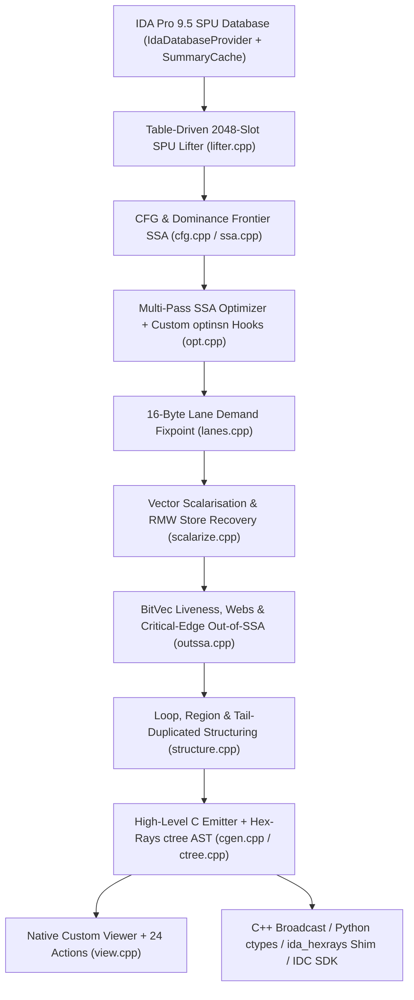

# spudec — Native C++17 Cell SPU Decompiler & Scripting SDK for IDA Pro 9.5

`spudec` is a compiled native C++17 decompiler plugin (`spudec.dll`) and multi-language scripting SDK (`C++`, `IDAPython`, `ida_hexrays` shim, and `IDC`) for the Cell Broadband Engine Synergistic Processing Unit (`PLFM_SPU`), built for IDA Pro 9.5+.

It pairs a standalone zero-IDA-dependency decompiler engine (`spudec_core.lib`) with an interactive Hex-Rays-parity pseudocode viewer (`SpuVdui`), incremental IDB summary caching (`SummaryCache`), `$ spudec` netnode persistence, and an automatic `PLFM_SPU`-scoped `ida_hexrays` compatibility bridge so generic IDA scripts and MCP tools work out-of-the-box.



---

## Performance Benchmarks (IDA Pro 9.5 x64, MSVC `/O2`)

| Corpus | Functions | Legacy Python (`ms`) | Native C++ Cold (`ms`) | Cold Avg / Median (`ms/func`) | Native C++ Warm (`ms`) | Speedup |
| :--- | :---: | :---: | :---: | :---: | :---: | :---: |
| `lv0ldr.dec.i64` | 398 / 398 (`0` fails) | `15,788.2 ms` | **`1,440.0 ms`** | `3.62 ms` / **`1.16 ms`** | **`15.0 ms`** (`0.038 ms/fn`) | **11.0× cold / 1,051× warm** |
| `metldr.356.sym.elf.i64` | 189 / 189 (`0` fails) | — | **`400.0 ms`** | `2.12 ms` / **`0.75 ms`** | **`7.0 ms`** (`0.037 ms/fn`) | Sub-millisecond median |

- **Worst-function latency (`lv0ldr`)**: dropped **16.4×** from `1,579.0 ms` in Python to **`96.4 ms`** in C++.
- **Token occurrence highlighting**: **`< 0.2 ms`** in-place `cfunc_t::recolorize` without re-running the pipeline.

---

## Interactive Viewer & Hex-Rays Parity (`spudec - Pseudocode`)

- **Native `F5` Integration (`PLUGIN_PROC | PLUGIN_MULTI`)**: Activates strictly when `PH.id == PLFM_SPU` (`59`) and returns `nullptr` immediately on all non-SPU databases so native Hex-Rays on x86/x64/ARM/PPC/MIPS is never affected.
- **Zero-Mutation Theme-Aware Sync Highlighting**: Uses IDA 9.5 `ui_get_lines_rendering_info` (`CK_EXTRA1`) to highlight synchronized disassembly instructions across light and dark themes without dirtying the IDB or undo history.
- **Clean Navigation History (No Scroll Flooding)**: Moving the cursor inside a function syncs disassembly with `UIJMP_IDAVIEW | UIJMP_DONTPUSH` while callees, symbols, `G`, and cross-function jumps record clean history entries (`Esc` / `Ctrl+Enter`).
- **100% Backward-Compatible `$ spudec` Netnode Storage**: Reads and writes existing JSON annotations (`renames`, `types`, `proto`, `lvars`, `cmts`, `numforms`, `iflags`, `altval(0)` sync, `altval(1)` `hide_casts`, and window dock state), plus IDA Teams 3-way merge handlers (`merge.cpp`).

| Shortcut | Action |
| :--- | :--- |
| `F5` | Open / focus SPU pseudocode view (or refresh when inside pseudocode) |
| `Ctrl+F5` | Decompile all functions in the binary (with `.c` file export) |
| `Ctrl+Shift+S` | Clear cached summaries and `cfunc_t` objects |
| `N` | Rename local variable, parameter, function, callee, global, or label |
| `Y` | Set C type on local/parameter/global or full C/C++ function prototype |
| `/` or `;` | Add or edit statement / function comment |
| `H` | Toggle hexadecimal ↔ decimal constant format |
| `R` | Toggle character literal (`'A'`) format |
| `A` | Create Local Store C string (`STRTYPE_C`) or packed big-endian ASCII constant |
| `B` | Toggle binary (`0b...`) literal format |
| `_` (`Shift+-`) | Toggle signed ↔ unsigned decimal representation |
| `~` (`Shift+\``) | Toggle bitwise negated (`~0x...`) constant format |
| `O` | Toggle Local Store symbol/offset (`&sym`) representation |
| `M` | Format constant as an IDA Enum symbolic member |
| `I` | Invert `if` condition and swap `then` / `else` branches |
| `\` | Toggle hiding/showing scalar casts |
| `X` | Show local variable xrefs (modal chooser) or global/callee IDA xrefs |
| `G` | Jump to function or Local Store address |
| `Tab` | Switch focus to matching instruction in `IDA View-A` |
| `Esc` / `Ctrl+Enter` | Navigate backward / forward in pseudocode history |
| `Alt+S` | Toggle live cursor synchronization with disassembly |
| `Shift+I` | Toggle between C pseudocode and lifted SSA/OutSSA IR |

---

## Multi-Language Decompiler Scripting SDK

### 1. Zero-Change `ida_hexrays` Scripts & MCP Tools (Automatic on `PLFM_SPU`)
`spudec_hexrays_bridge.py` installs a `PLFM_SPU`-gated proxy on `ida_hexrays` when an SPU database opens (delegating 100% transparently to real `ida_hexrays` on non-SPU databases):

```python
import ida_hexrays

assert ida_hexrays.init_hexrays_plugin()
cf = ida_hexrays.decompile(0x410)
print(cf)  # Full C pseudocode

class CallCollector(ida_hexrays.ctree_visitor_t):
    def __init__(self):
        super().__init__(ida_hexrays.CV_PARENTS)
        self.calls = []

    def visit_expr(self, e):
        if e.op == ida_hexrays.cot_call:
            self.calls.append((e.ea, e.dstr()))
        return 0

v = CallCollector()
v.apply_to(cf.body, None)
```

AST nodes can also be mutated in Python (either directly or inside `Hexrays_Hooks.maturity`) and re-rendered via `cf.refresh_func_ctext()`.

### 2. Python `spudec` Package & Custom IR Passes
```python
import spudec

print(spudec.decompile(0x410))          # Plain C string
print(spudec.dump(0x410))               # Lifted & optimized IR dump
spudec.db.set_var_rename(0x410, "r3", "ctx")
spudec.db.set_func_proto(0x410, "int process_pkg(pkg_hdr_t *ctx, uint32_t len);")

# Register a custom IR optimization pass
h = spudec.register_optinsn(lambda fea, blk, idx, op, iea: 0)
spudec.unregister_optinsn(h)
```

### 3. Native C++ Plugin-to-Plugin SDK (`include/spudec/spudec_api.hpp`)
External C++ IDA plugins can include header-only `spudec/spudec_api.hpp` (no link dependency on `spudec.lib`):
```cpp
#include <spudec/spudec_api.hpp>

if (auto cf = spudec::sdk::decompile(func_ea)) {
    msg("%s\n", cf->print_func().c_str());
}
```

### 4. Built-in IDC Functions
`spudec.dll` registers 12 native IDC functions on SPU databases:
`spudec_version()`, `spudec_decompile(ea)`, `spudec_dump_ir(ea)`, `spudec_decompile_all(out_path)`, `spudec_open_pseudocode(ea, flags)`, `spudec_rename_lvar(func_ea, old, new)`, `spudec_set_lvar_type(func_ea, var, type)`, `spudec_set_proto(func_ea, proto)`, `spudec_set_cmt(func_ea, stmt_ea, cmt)`, `spudec_set_numform(func_ea, stmt_ea, op_idx, form)`, `spudec_invert_if(func_ea, branch_ea)`, and `spudec_mark_dirty(func_ea)`.

---

## Building, Testing & Deploying

### Prerequisites
- Visual Studio 2022 / 2026 x64 C++17 toolchain (`cl.exe`), CMake 3.20+, and Ninja
- IDA Pro 9.5 SDK (`IDA_SDK_DIR` auto-detected when inside `ida-sdk/src/plugins/spudec`)

### Build & Run Standalone C++ Unit Tests
```powershell
cmake -S . -B build -G Ninja -DCMAKE_BUILD_TYPE=Release
cmake --build build --parallel
.\build\spudec_tests.exe
```

### Deploy to User IDA Plugins Directory (`%APPDATA%\Hex-Rays\IDA Pro\plugins`)
```powershell
cmake --build build --target spudec_deploy
```
This installs `spudec.dll`, `spudec_hexrays_bridge.py`, and the `spudec/` Python FFI package into `%APPDATA%\Hex-Rays\IDA Pro\plugins\` (retiring legacy `spudec_plugin.py`).

### Headless IDA Pro 9.5 Verification & Corpus Benchmark
Run `ctests/ida_verify_and_bench.py` via `idat.exe -A -Sctests/ida_verify_and_bench.py <copy_of_db.i64>` (setting `SPUDEC_BENCH_JSON=out.json`) to validate zero-import `ida_hexrays`, `ctree_visitor_t`, AST mutation, `Hexrays_Hooks`, `$ spudec` netnode backward compatibility, custom `optinsn` hooks, IDC functions, and full-corpus latency.
